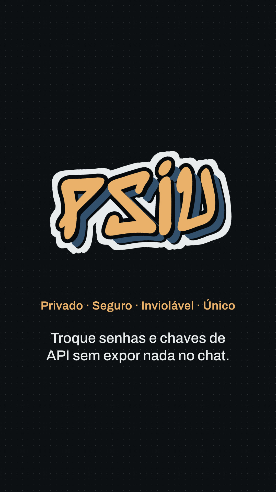

# PSIU — Privado, Seguro, Inviolável, Único

**Pass passwords, tokens and API keys through any chat without leaving them in the history.**
Everything is encrypted in your browser; nothing is sent to a server.

**Live:** https://psiu.ezequielmagmorais.workers.dev



A secret pasted into WhatsApp, Slack or e-mail stays in the history forever, on every device and
backup of everyone in the conversation. PSIU replaces it with two links that are useless to anyone
but the person who asked.

## How it works

1. **Pedir (request).** You create a request link and send it. The browser generates an ECDH P-256
   key pair; the public key goes in the link (`#k…`), the private key stays in this browser's
   `localStorage`.
2. **Enviar (send).** The person with the secret opens the link, types it and locks it. Their browser
   creates a one-off key pair, derives an AES-256-GCM key with HKDF-SHA256 and returns a **reply
   link** (`#rcad1.…`).
3. **Abrir (open).** You open the reply link in the same browser. PSIU finds the matching request
   among the ones stored there and decrypts it. Then you delete the request, and that reply link
   never opens again.

Both sides see the same **código de conferência** (verification code). Read it to each other over a
call: if it matches, nobody swapped the link on the way.

### Format

```
reply link = <page>#r cad1.<kid>.<ephemeral public key>.<iv>.<ciphertext>   (base64url)
kid        = first 6 bytes of SHA-256(recipient public key)
key        = HKDF-SHA256(ECDH(ephemeral, recipient), salt = ephemeral ‖ recipient, info = "cadeado-v1")
cipher     = AES-256-GCM, random 12-byte IV
```

## Security model

- **No server involved.** Links carry their payload after the `#`, which browsers never send to any
  server. The page's Content-Security-Policy sets `connect-src 'none'`: once loaded it cannot talk
  to anything. Served with `frame-ancestors 'none'`, `no-referrer` and related headers
  (`public/_headers`).
- **Tampering is detected.** AES-GCM refuses a reply link that was cut or altered.
- **Confirm the code.** Without that check, someone who controls the channel could swap the request
  link for their own.
- **The private key lives in your browser.** Anyone with access to that browser profile can open
  your pending requests; delete a request once you have used the secret. Clearing site data deletes
  them too.
- Not audited. Uses only the browser's Web Crypto API; no third-party JavaScript.

## Run locally

```bash
python3 -m http.server 8771 --bind 127.0.0.1 --directory public
```

Open http://localhost:8771. Web Crypto needs a secure context: `localhost` or HTTPS.

## Deploy (Cloudflare Workers, static assets)

```bash
npx wrangler login
npx wrangler deploy
```

The whole app is `public/index.html`; `public/_headers` adds the security headers.

## Launch video

`brag-output/` holds the launch video (vertical 1080×1920) and the scripts that build it from the
real page: `work/build.py` assembles the scenes, `work/music.py` writes the soundtrack,
`work/capture.mjs` renders frames with headless Chrome. Made with [/brag](https://github.com/latent-spaces/brag).

## License

[MIT](LICENSE) © 2026 Ezequiel Magalhães —
[LinkedIn](https://www.linkedin.com/in/ezequiel-magalhaes/) · [GitHub](https://github.com/zeekias)
